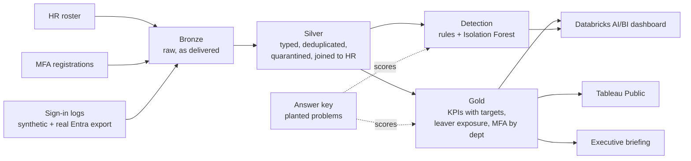

# Identity Security Metrics: Databricks, Machine Learning and Dashboards

**Status: 🔨 In progress.** The design, data generator and Databricks notebooks are written and tested locally. The run in Databricks, the dashboards and the results come next, and get added here as they're done.

Identity security metrics for **Potomac Defense Systems (PDS)**, the fictional defense contractor from my IAM portfolio. HR records, MFA registrations and sign-in logs go into **Databricks**, through a bronze → silver → gold pipeline, and come out as **metrics that matter**, detections for suspicious sign-ins (rules versus **machine learning**), dashboards in **Databricks and Tableau**, and a one-page executive briefing.

> **About this project:** PDS is fictional, and the 340-employee dataset is **synthetic**, generated by a script in this repo and labeled as such everywhere. A separate query exports real sign-ins from my Entra ID tenant to prove the pipeline works on real logs, but that export never goes in the repo or on Tableau Public.

---

## Why this project

My IAM projects build controls: lifecycle automation, Conditional Access, PIM, federation. This one asks **whether the controls are working**, and how you'd show that to a security leader:

| Question | What this project builds |
|---|---|
| Can anyone still get in with only a password? | MFA coverage, single-factor sign-ins and legacy authentication, as tracked metrics with targets |
| Would our MFA survive phishing? | Phishing-resistant MFA rates for all users and for admins, by department |
| Do leavers lose access on time? | Sign-ins after HR termination and days from termination to disable, joining HR to sign-in logs |
| Can we spot account takeover? | Rules and an Isolation Forest model scored against an answer key of planted attacks |
| Is the data trustworthy? | Data quality checks whose results are a table, not a silent filter |

## How it works

## What it measures

| Metric | Target |
|---|---|
| MFA registration coverage | 100% |
| Phishing-resistant MFA: all users / privileged | 50% interim / 100% |
| Successful sign-ins with a single factor | 0% |
| Users on legacy authentication | 0 |
| Dormant accounts (45+ days) | 0 |
| Leavers who signed in after termination · never disabled | 0 · 0 |
| Days from termination to disable: median / worst case | 0 / ≤ 1 |
| Risky sign-ins that succeeded | 0 |
| Identities signing in that HR doesn't know | 0 |

Full definitions, the planted scenarios and the detection logic are in [`docs/01-design.md`](docs/01-design.md).

## Parts

| Part | What gets built | Status |
|:---:|---|:---:|
| **1** | Synthetic PDS dataset with an answer key of planted problems, plus a real Entra sign-in export | Code ready |
| **2** | Bronze and silver: landing, typing, deduplication, quarantine, data quality checks, join to HR | Code ready |
| **3** | Gold: KPIs with targets and the lists behind them | Code ready |
| **4** | Detection: rules vs Isolation Forest, scored for precision and recall per scenario | Code ready |
| **5** | Dashboards: Databricks AI/BI and Tableau Public | Planned |
| **6** | Executive briefing | Planned |

## Repository

| Path | What's in it |
|---|---|
| [`data/generate_pds_identity_data.py`](data/generate_pds_identity_data.py) | Deterministic generator: 340 employees, 90 days of sign-ins, planted problems and dirty data |
| [`notebooks/`](notebooks/) | Databricks notebooks in source format: config, data generation, bronze, silver, gold, detection |
| [`queries/export-entra-signins.kql`](queries/export-entra-signins.kql) | Exports real Entra sign-ins from Log Analytics |
| [`dashboards/`](dashboards/) | Dashboard specs for Databricks and Tableau Public |
| [`docs/`](docs/) | The design and the executive briefing |
| [`tools/run_local.py`](tools/run_local.py) | Runs the notebooks with local Spark, to test changes before uploading |

## Running it

**Databricks Free Edition**
1. Sign up for Databricks Free Edition, then **Workspace → Create → Git folder** with this repo's URL
2. Open `notebooks/00_generate_data` and run it. It creates the `pds_identity` schema and `raw` volume and writes the CSVs there
3. Run notebooks `01` → `04` in order
4. Build the dashboard from [`dashboards/databricks-dashboard.md`](dashboards/databricks-dashboard.md)

**Locally** (for testing): `pip install -r requirements.txt`, then
`python data/generate_pds_identity_data.py --out data/output` and `python tools/run_local.py --raw data/output`.

## Skills this project covers

Databricks · Apache Spark (PySpark, Spark SQL) · Delta tables · medallion architecture · data quality checks · Unity Catalog volumes · identity security metrics · KPI design · anomaly detection · Isolation Forest (scikit-learn) · precision and recall · AI/BI dashboards · Tableau · executive reporting · Entra ID sign-in logs · KQL

---

Built by **Josh Agble** · [github.com/jagble](https://github.com/jagble) · Designed with Claude as a mentor and pair programmer
